<div align="center">


### Test your knowledge. Beat the clock.

<p>A simple and fun Flutter app for playing trivia quizzes with questions from Open Trivia DB.</p>


</div>

<br />

## About

Quiz App lets you challenge yourself with trivia questions from many categories. Choose the number of questions, category, difficulty, and question type, answer before the timer runs out, and review your results in the history.

## Features

- Questions loaded from Open Trivia DB
- Multiple choice and True/False questions
- Choose category, difficulty, and number of questions
- 15-second timer for each question
- Skip button for hard questions
- Result screen with correct, wrong, and skipped answers
- Quiz history saved locally
- Delete a single result or clear the whole history
- Light and dark themes

## Built With

- [Flutter](https://flutter.dev/)
- [Dart](https://dart.dev/)
- [Flutter Bloc](https://pub.dev/packages/flutter_bloc)
- [Dio](https://pub.dev/packages/dio)
- [Hive](https://pub.dev/packages/hive_flutter)
- [Open Trivia DB](https://opentdb.com/)

## Getting Started

### Prerequisites

- Flutter SDK
- Dart SDK
- Android Studio or Xcode for mobile development
- Internet connection (questions are loaded from the API)

### Installation

```bash
git clone https://github.com/your-username/quiz_app.git
cd quiz_app
flutter pub get
flutter run
```

## Project Structure

```text
lib/
├── app/
│   ├── quiz_app.dart        # App configuration and themes
│   └── home_shell.dart      # Bottom navigation
├── core/
│   ├── theme/               # Colors and light/dark themes
│   └── widgets/
│       └── labeled_dropdown.dart  # Reusable dropdown field
├── features/
│   ├── quiz/
│   │   ├── data/
│   │   │   └── trivia_client.dart  # Open Trivia DB requests (Dio)
│   │   ├── domain/                 # Question, category, quiz settings
│   │   ├── logic/
│   │   │   ├── setup_cubit.dart    # Quiz settings and loading
│   │   │   └── quiz_cubit.dart     # Quiz progress and timer
│   │   └── ui/
│   │       ├── quiz_setup_page.dart # Main screen
│   │       ├── question_page.dart   # Multiple choice and True/False
│   │       └── result_page.dart     # Quiz result
│   ├── history/
│   │   ├── data/
│   │   │   └── history_repository.dart # Local storage (Hive)
│   │   ├── domain/
│   │   │   └── quiz_result.dart        # Result model
│   │   ├── logic/
│   │   │   └── history_cubit.dart      # History state management
│   │   └── ui/
│   │       └── history_page.dart       # History screen
│   └── settings/
│       ├── logic/
│       │   └── theme_cubit.dart        # Theme state management
│       └── ui/
│           └── settings_page.dart      # App settings screen
└── main.dart                # Application entry point
```

## Demo

<div align="center">
	
</div>

## License

This project is for learning and personal use.

<br />


